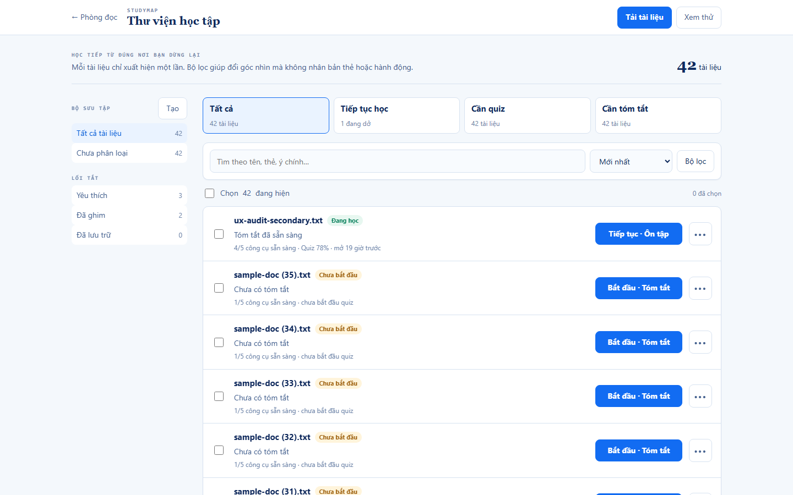
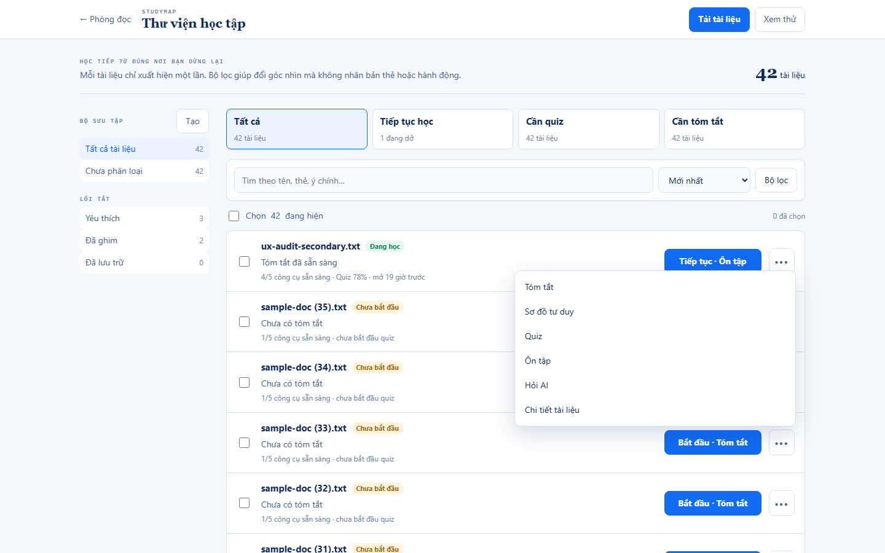
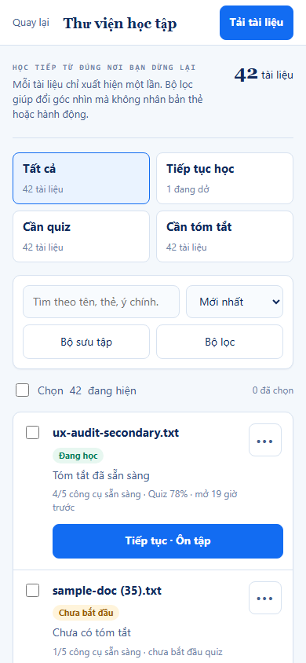

# Document Library redesign — Alternative A: Canonical Learning Queue

Status: first-alternative draft for review, 2026-10-25. Design/prototype only; no `FE/src/**` files changed.

## Decision in one sentence

Render each document exactly once in a canonical, keyboard-navigable result list; turn “Continue,” “Needs quiz,” and “Needs summary” into aggregate filters that change the list rather than duplicate it; give each row one primary resume action and put the preserved document-scoped tools in a contextual menu.

## 1. BEFORE — new evidence from the real local stack

This baseline was captured in this phase, not reused from Phase A. The capture script registered a fresh disposable account through `/register`, navigated to `/app/study`, uploaded `FE/e2e/fixtures/sample-doc.txt` through the real hidden file input, and measured the resulting DOM against Flask on `8091` and Postgres `studymap_test`.


The full desktop evidence is [before-desktop-full-page.png](evidence/before-desktop-full-page.png); the raw reproducible measurements are [before-measurements.json](evidence/before-measurements.json).

Important environment limit: `run_e2e_server.py` does not enable the production `AUTH_PROTECT_APP_APIS=true` posture, so this fresh local account saw accumulated test documents. That makes this an intentionally dense fixture for structural measurement, not evidence of a current production ownership leak. The duplicate-render problem itself is independent of ownership: 42 distinct document names became 216 full card instances.

### Measured current state

| Measurement | Desktop 1440×900 | Mobile 390×844 |
|---|---:|---:|
| Unique documents in rendered cards | 42 | 42 |
| Full `StudyCard` instances | 216 | 216 |
| Duplicate card instances | 174 | 174 |
| Cards per unique document | 5.14 | 5.14 |
| Visible interactive controls | **1,755** | **1,750** |
| Controls inside repeated cards | 1,733 | 1,733 |
| Document height | 41,651 px | 56,922 px |
| Horizontal overflow | none | none |

The current structure repeats the same full action set under `Tiếp tục học`, recent-time sections, `Chưa mở bao giờ`, `Cần tóm tắt`, `Cần sơ đồ`, `Cần quiz`, and `Tất cả tài liệu`. The earlier 823-control audit was therefore not an upper bound; this live fixture measured 1,755.

## 2. AFTER desktop mockup

Runnable prototype: [prototype-alternative-a.html](prototype-alternative-a.html)



The page keeps the existing blue identity, collection sidebar, search, sort, filter, upload, bulk selection, and document-level workflows. The structural changes are:

1. “Tất cả,” “Tiếp tục học,” “Cần quiz,” and “Cần tóm tắt” are count-bearing filters, not repeated record sections.
2. The canonical list contains one row per `document_id`.
3. Every row has exactly one primary resume/start action derived from existing `tiepTucHoc(doc)` semantics.
4. Status is summarized in two compact lines rather than six independent chips plus a full action strip.
5. Secondary document-scoped actions remain available from the named contextual trigger.



The open menu proves the “keep as contextual shortcut” decisions remain intact: Tóm tắt, Sơ đồ tư duy, Quiz, Ôn tập, Hỏi AI, and Chi tiết tài liệu are preserved. This direction changes their presentation hierarchy, not their routing semantics.

## 3. AFTER mobile mockup



Mobile uses the same canonical list and order. Quick views become a 2×2 filter grid; search and sort remain above the list; desktop collection navigation becomes a labelled `Bộ sưu tập` control rather than disappearing; every primary and contextual action is at least 44 px high. No horizontal overflow was measured.

## 4. Interaction wireflow

```mermaid
flowchart TD
    A[Open /app/study] --> B[Restore library query, sort, view and scroll]
    B --> C[Canonical result list: one row per document_id]
    C --> D{User intent}
    D -->|Resume| E[Activate the one primary action]
    E --> F[useOpenSurface / duongDi chooses destination]
    F -->|Summary, Mind Map, Ask AI| G[/app?source=source_stem]
    F -->|Study Map, Quiz, Review| H[/app/study route keyed by UUID or attempt ID]
    G --> I[Workspace resolves STEM and preserves its mounted panes]
    H --> J[Study route resolves UUID-backed document/activity]
    I --> K[Browser Back]
    J --> K
    K --> B

    D -->|Secondary tool| L[Open contextual menu for this row]
    L --> F
    D -->|Find| M[Search / sort / collection / smart-view filter]
    M --> C
    D -->|Manage several| N[Select UUID-backed rows]
    N --> O[BulkBar action on visible selection only]
    O --> C
```

### Keyboard contract

- Exactly one canonical row participates in the list's roving `tabIndex` at a time.
- `ArrowUp` / `ArrowDown` moves the active row; the prototype measured `doc-1 → doc-2` successfully.
- `Space` toggles the row's management checkbox; `Escape` clears selection using the existing bulk-selection convention.
- `Enter` invokes the row's one primary action.
- Inner controls stop propagation so using a checkbox, primary action, or menu item cannot be reinterpreted as a row command.
- Opening the contextual menu moves focus into its first action; closing it must restore focus to that row's trigger in implementation.

## 5. Component ownership map

| Concern | Canonical owner | Alternative A responsibility | Must not own |
|---|---|---|---|
| Fetch and mutation state | `DocumentList.jsx` | Continue loading `/api/library`, progress data, upload, optimistic metadata updates, filters, sort, bulk UUID set, and roving index. Replace category-to-card rendering with one canonical projection. | Workspace AI source scope. |
| One rendered document identity | `StudyCard.jsx` evolved into a row variant, or a new `StudyDocumentRow` extracting its logic | Render title, compact progress, one primary action, one contextual trigger, selection semantics, rename/menu state, and optional details disclosure. | Deciding route strings independently. |
| Aggregate “smart views” | New presentational `LibrarySmartViews` under `DocumentList` | Render counts and set the current predicate (`all`, `continue`, `needs_quiz`, `needs_summary`). No document names or cards. | A second result collection. |
| Collections/tags/shortcuts | `CollectionSidebar.jsx` | Preserve desktop filters; expose the same items through one labelled mobile drawer/popover. | AI source selection or document cards. |
| Search/filter/sort | `DocumentList.jsx` + existing `thuVienTaiLieu.js` pure functions | Keep one visible search field, one sort select, active filter feedback, deterministic results, and visible-count scope. | Server-side duplicate sections. |
| Primary resume decision | Existing `tiepTucHoc(doc)` | Supply the label and existing surface to the row. New/unopened documents get one explicit start target. | A new competing “last activity” algorithm. |
| Route construction and open tracking | Existing `useOpenSurface()` + `duongDi()` | Remain the only route/open-history path for primary and secondary actions. | Row-local URL templates or duplicate `markOpened` calls. |
| Bulk actions | Existing `BulkBar.jsx` + `chonNhieu.js` | Operate on the visible canonical row UUID set; selected rows stay visually explicit. | Workspace selected sources. |
| Return path | Router history + `StudyBreadcrumb.jsx` | Preserve library query/view/scroll state across document workflows; breadcrumb parent segments become real navigation in the later implementation round. | Identity conversion by display name. |
| Expanded knowledge/detail content | Existing `KnowledgePanel.jsx` lifecycle | Open only within the one canonical row or a dedicated detail surface; reuse its cache/loading/error behavior. | A second copy of the row in an insight section. |

## 6. State-transition contract: STEM in `/app`, UUID in `/app/study`

The redesign must treat identity as a tagged boundary, never as one interchangeable string.

| Transition | Source identity | Destination identity | Required mechanism | Forbidden shortcut |
|---|---|---|---|---|
| Load/render library | `document_id` UUID from `/api/library` | `/app/study` row key and selection key remain UUID | `key={doc.document_id}`; `Set<document_id>` for bulk selection | Keying by title, filename, index, or `source_stem`. |
| Library → Summary / Mind Map / Ask AI | Row has both UUID and `source_stem` | `/app` consumes STEM | Call `useOpenSurface(doc, surface)`, which delegates to `duongDi()` and emits `/app?source=<source_stem>` | Writing the UUID into Workspace `selectedDocument`; hand-building `/app` URLs in the row. |
| Library → Study Map | UUID | `/app/study/map/:documentId` consumes UUID | Existing `duongDi(doc, "studymap")` | Converting UUID to stem before routing. |
| Library → new/existing Quiz | UUID plus optional latest quiz ID | `/app/study/quiz/new?document=<UUID>` or quiz ID route | Existing `duongDi(doc, "quiz")` | Treating a source stem as a document query ID. |
| Library → Review / Practice | UUID-backed document plus latest attempt ID | Attempt route, falling back to the UUID-backed Study Map | Existing `duongDi(doc, "review")` | Guessing an attempt from the filename or title. |
| Workspace → Library via Back | Workspace Context holds STEM | Library restores its own UUID-keyed list state | Browser history restores query/filter/sort/scroll; library state remains separate from Study Context | Translating the current Workspace stem into the library's bulk-selection set. |
| Study route → Workspace shortcut | Study route resolves the UUID-backed record | Explicitly bridge through that record's `source_stem` | Fetch document by UUID, then use its `source_stem` for `/app` handoff | Assuming UUID equals stem, or storing both under one untagged value. |

Invariant: the redesign does **not** change `StudyContextProvider`, `WorkspaceContainer`, backend identifiers, or the existing `duongDi()` mapping. The row always passes the whole canonical document record into the existing routing helper so the correct identity can be chosen at the boundary.

Also invariant: library management selection and Workspace source scope remain distinct. “Chọn 42 đang hiện” means UUID-backed records for bulk management; it must never silently become the STEM-backed “Nguồn đang dùng” set for Chat/Mind Map/Summary.

## 7. Measured before/after control count

The prototype was rendered in real headless Chromium and counted with the same visibility predicate and interactive selector as the current UI. Raw output: [after-a-measurements.json](evidence/after-a-measurements.json). Capture/measurement is reproducible with [capture_current_state.py](capture_current_state.py) and [capture_prototype.py](capture_prototype.py).

| Measurement | Current desktop | Alternative A desktop | Change |
|---|---:|---:|---:|
| Unique identities | 42 | 42 | preserved |
| Rendered document cards/rows | 216 | 42 | −174 (−80.6%) |
| Duplicate record instances | 174 | **0** | eliminated |
| Visible interactive controls | 1,755 | **144** | −1,611 (−91.8%) |
| Visible controls with one document menu open | n/a | 150 | +6 only while requested |
| Primary resume actions | repeated per card | **42, exactly one per row** | canonicalized |
| Contextual action triggers | repeated per card | **42, exactly one per row** | canonicalized |
| Document height | 41,651 px | **4,608 px** | −88.9% |
| Horizontal overflow | none | none | preserved |

| Measurement | Current mobile | Alternative A mobile | Change |
|---|---:|---:|---:|
| Rendered document cards/rows | 216 | 42 | −174 (−80.6%) |
| Duplicate record instances | 174 | **0** | eliminated |
| Visible interactive controls | 1,750 | **138** | −1,612 (−92.1%) |
| Document height | 56,922 px | **8,407 px** | −85.2% |
| Horizontal overflow | none | none | preserved |

Why the count is not “six actions removed per document”: those actions still exist. Their buttons become visible only after the user requests one row's contextual menu, so the default page does not expose 252 secondary actions simultaneously. With one menu open, the measured total rises from 144 to 150, and the six preserved labels are verified in the JSON evidence.

## 8. Regression risks and rollout strategy

| Risk | Failure mode | Mitigation / acceptance gate |
|---|---|---|
| Section semantics | Analytics, headings, or scroll anchors expect repeated section arrays. | Introduce smart-view predicates behind a feature flag; instrument view selection rather than card impression per section; preserve legacy anchors as redirects to the corresponding filter. |
| Primary-action drift | New label or destination diverges from `tiepTucHoc()` / `duongDi()`. | No row-local route logic. Contract tests enumerate all six surfaces and assert UUID-vs-STEM destinations. |
| Lost contextual shortcut | Moving actions into a menu makes one disappear or changes source handoff. | One Playwright assertion per “keep contextual shortcut” verdict: Summary, Mind Map, Quiz, Review, Ask AI, Details. Verify inherited document context on arrival. |
| Roving focus regression | Filter/sort removes the focused row, leaving focus nowhere or on a detached element. | Clamp the focused index after every projection change; focus the first result or the search field when the result set becomes empty. Test Arrow/Space/Enter/Escape and menu focus return. |
| Bulk-selection scope | Hidden/filtered UUIDs remain selected and are mutated. | Keep the existing `locTheoHienThi` pruning behavior; bulk summary names the visible scope before destructive actions. |
| Mobile discoverability | Desktop sidebar disappears without an equivalent. | The mobile `Bộ sưu tập` control must open the same collection/tag/shortcut model, isolate background focus, and restore focus on close. |
| Return-state loss | Back returns to the top or resets query/filter/sort after quiz/map/workspace. | Store library projection and scroll position in the history entry; verify Library → each surface → Back for both `/app` and `/app/study` destinations. |
| Details/knowledge cache | Consolidation remounts the only row and discards a loaded `KnowledgePanel`. | Keep row keys stable by UUID; preserve current lazy-load/cache ownership or move it to an ID-keyed parent cache before changing presentation. |
| Count disagreement | Top summary, visible count, and bulk label read from different datasets. | Derive all three from the same canonical projected array; add a screen-reader assertion that the announced counts agree. |

### Staged rollout

1. **Shadow projection:** compute the canonical `visibleDocuments` array alongside current `chiaMuc()` output; log identity/count parity in development without changing UI.
2. **Feature-flagged Alternative A:** render the new canonical list for internal/test accounts. Keep existing route helpers and mutations unchanged.
3. **Contract suite:** fixed 42-document fixture; assert 42 rows, 42 unique UUIDs, zero duplicates, one primary action per row, every preserved shortcut, bulk-selection pruning, roving keyboard behavior, mobile drawer focus containment, and all return paths.
4. **Performance/a11y gate:** compare DOM nodes, controls, page height, accessible-name repetition, and long-task timing at 20/100/300 documents.
5. **Progressive exposure:** 10% → 50% → 100%, watching resume/action conversion, search-to-open time, menu-open rate, back-return success, and bulk-operation errors.
6. **Rollback:** the flag restores the current section renderer without data migration because the proposal changes only projection and interaction hierarchy; API payloads and identities remain unchanged.

## Alternative A trade-off

This is the lowest-cognitive-load direction: scanning and keyboard traversal improve dramatically, and the identity/routing boundaries remain untouched. Its cost is one extra click for non-primary document tools. That click is deliberate and contextual, but Alternative B should explore a different balance (for example, a row with a persistent two-action tool cluster) before a direction is selected.
