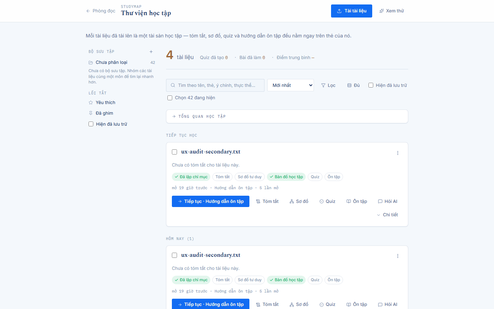
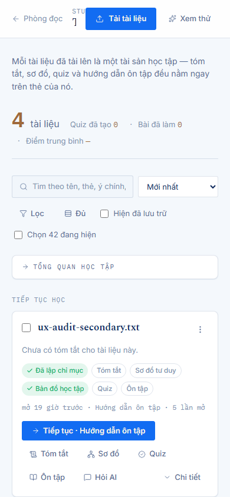
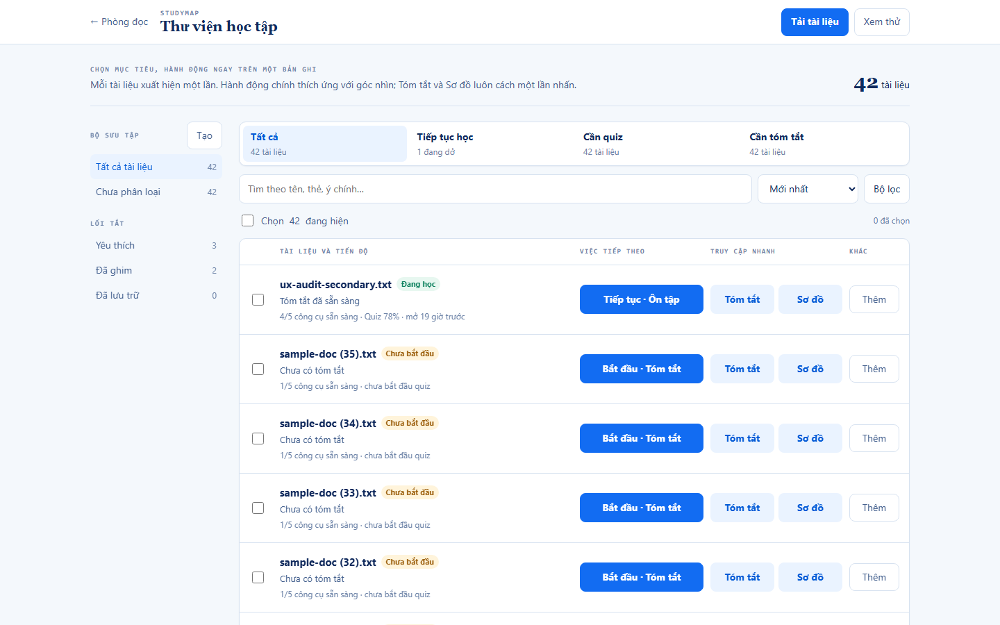
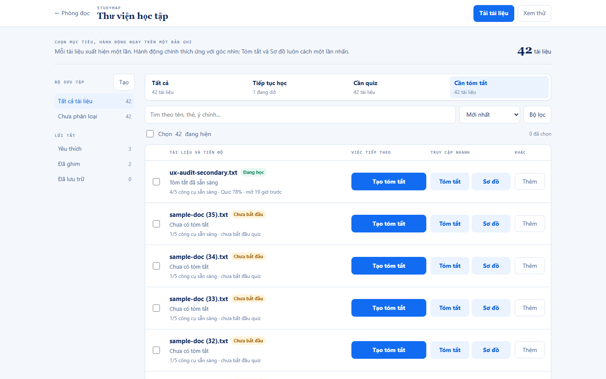
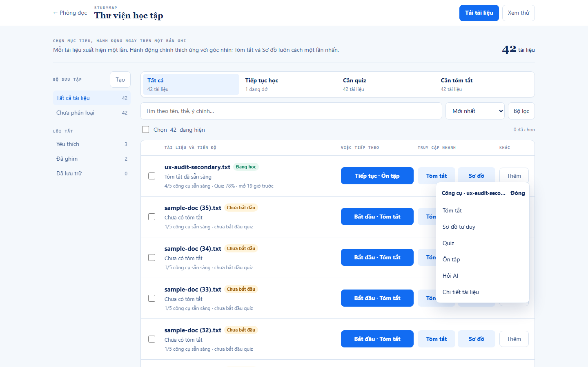
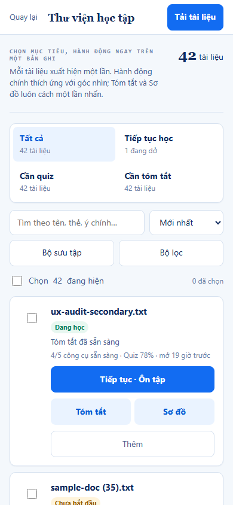
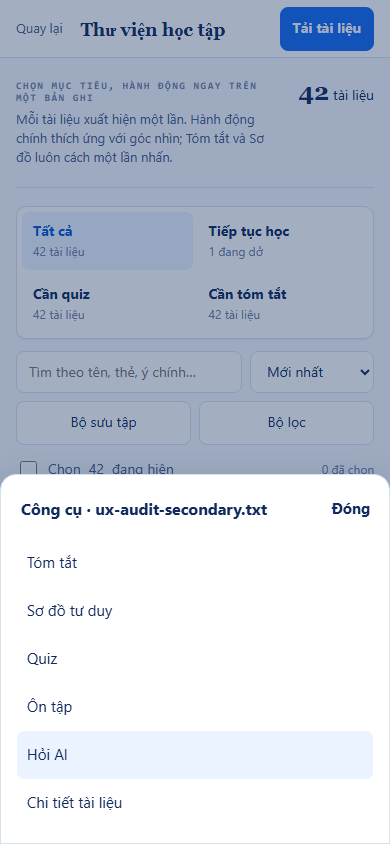

# Document Library redesign — Alternative B: Learning Action Matrix

Status: complete second alternative, 2026-10-25. **Selected candidate for the Document Library contract.** Design/prototype only; no `FE/src/**` files changed.

## Selection

**Select Alternative B for implementation planning.** It accepts 83 more visible controls than Alternative A on the 42-document fixture (227 instead of 144) in exchange for restoring one-click access to the two highest-frequency cross-study actions, making task-view intent and the primary CTA agree, fixing the focus model, and replacing the mobile floating menu with an isolated bottom sheet. It still removes 87.1% of the current desktop controls and all 174 duplicate record instances.

Alternative A remains a valid lower-density fallback if later telemetry shows users overwhelmingly follow only the recommended resume action. It is not the selected default because it imposes a second click and a six-item rescan on every Summary/Map switch—the exact multi-modal study behavior this library exists to support.

## 1. BEFORE — real current-state evidence

The baseline was captured during this design phase against the real local Flask/Postgres stack: fresh UI registration, a real upload of `FE/e2e/fixtures/sample-doc.txt`, then DOM and geometry measurement on `/app/study`.





Raw evidence: [before-measurements.json](evidence/before-measurements.json) and [full current desktop page](evidence/before-desktop-full-page.png).

The local E2E server does not enable production's `AUTH_PROTECT_APP_APIS=true` posture, so the disposable account saw accumulated test documents. This is a dense structural fixture, not a claim of a current production ownership leak. The rendering result is still unambiguous: 42 unique document names became 216 complete cards.

| Current measurement | Desktop 1440×900 | Mobile 390×844 |
|---|---:|---:|
| Unique documents | 42 | 42 |
| Full cards | 216 | 216 |
| Duplicate card instances | 174 | 174 |
| Visible interactive controls | **1,755** | **1,750** |
| Document height | 41,651 px | 56,922 px |

## 2. Alternative B concept

Alternative B treats the library as an **action matrix**, not a feed of cards:

- one canonical row per `document_id`;
- a goal-oriented view strip that changes both the result predicate and each row's primary CTA;
- one clear primary action per row;
- two persistent quick actions—`Tóm tắt` and `Sơ đồ`—for one-click cross-study work;
- a labelled `Thêm` trigger for Quiz, Review, Ask AI, Details, and lower-frequency tools;
- bulk selection as a distinct UUID-backed management column;
- direct-button roving focus, never a focusable row wrapping native controls;
- a mobile bottom sheet for the complete tool set.

Runnable prototype: [prototype-alternative-b.html](prototype-alternative-b.html).

## 3. AFTER desktop mockups



The desktop column grammar makes the interaction hierarchy explicit: document/progress, next action, two quick tools, and other tools. This costs more controls than Alternative A but removes hunting: Summary and Map stay one click away without restoring the current six-action strip.

### Task-view-adaptive action



When `Cần tóm tắt` is active, every visible primary action becomes `Tạo tóm tắt`; when `Cần quiz` is active, it becomes `Tạo quiz`. `Tất cả` and `Tiếp tục học` fall back to the existing `tiepTucHoc(doc)` resume decision. This fixes the mismatch where a user deliberately enters a summary queue but sees a Quiz-oriented primary CTA.

### Complete document tool set



The labelled `Thêm` popover retains all six document-scoped destinations. Summary and Map are intentionally present both as direct quick actions and in the complete tool list so keyboard/screen-reader users get a stable, exhaustive menu; the duplicate presentation exists only for the currently opened row, not across all records.

## 4. AFTER mobile mockups



Mobile keeps one primary action and two 44px quick actions on each canonical document card. Search, sort, collections, filters, and bulk scope remain visible before the results. Titles can occupy two lines.



`Thêm` opens a bottom sheet portalled outside the page subtree. The prototype verifies that the backdrop is visible, the page background is `inert`, focus enters the sheet, Escape closes it, and focus returns to the same document trigger. The sheet therefore cannot collide with or activate adjacent document cards while scrolling.

## 5. Interaction wireflow

```mermaid
flowchart TD
    A[Open /app/study] --> B[Restore view, query, sort, collection and scroll]
    B --> C[Canonical matrix: one row per document_id]
    C --> D{Choose intent}

    D -->|All / Continue| E[Primary CTA from tiepTucHoc doc]
    D -->|Needs Summary| F[Primary CTA = Create Summary]
    D -->|Needs Quiz| G[Primary CTA = Create Quiz]
    E --> H[useOpenSurface doc surface]
    F --> H
    G --> H

    D -->|Quick Summary| I[One-click Summary action]
    D -->|Quick Map| J[One-click Mind Map action]
    I --> H
    J --> H

    D -->|More| K{Viewport}
    K -->|Desktop| L[Anchored complete-tool popover]
    K -->|Mobile| M[Portalled modal bottom sheet]
    L --> H
    M --> H

    H -->|Workspace surface| N[/app?source=source_stem]
    H -->|Study surface| O[/app/study route keyed by UUID or attempt ID]
    N --> P[Browser Back restores library projection]
    O --> P
    P --> C

    D -->|Bulk manage| Q[UUID checkbox set]
    Q --> R[BulkBar acts on visible selection only]
    R --> C
```

### Keyboard/focus contract

- Row containers remain unfocusable; the measured count is zero focusable `.document-row` elements.
- Roving `tabIndex` belongs only to primary action buttons. `ArrowUp` / `ArrowDown` moves between those peer controls; the prototype verified `doc-1 → doc-2`.
- Checkboxes and quick-action buttons keep native semantics and ordinary Tab behavior.
- Two-line titles use the full title as a `title` fallback; the accessible name is never truncated.
- The desktop tool popover moves focus to its first action and restores the trigger on close.
- The mobile sheet is a modal focus scope: portalled outside inert background content, Tab-wrapped, Escape-dismissable, and focus-restoring.
- Filtering clamps the roving primary target to the first remaining row; an empty result moves focus to search and announces the result count.

## 6. Component ownership map

| Concern | Canonical owner | Alternative B responsibility | Must not own |
|---|---|---|---|
| Fetch, mutations and projection | `DocumentList.jsx` | Continue current fetch/upload/optimistic behavior. Produce exactly one filtered/sorted `visibleDocuments` array and one active task-view intent. | Route strings or Workspace source scope. |
| Goal-oriented view strip | New presentational `LibraryTaskViews` | Own `all`, `continue`, `needs_quiz`, `needs_summary` intent and counts. Each intent provides both a predicate and an optional primary-action override. | A second record collection or independent fetch. |
| Canonical document row | `StudyCard.jsx` logic extracted into `StudyDocumentActionRow`, or a row variant | Render one UUID-keyed identity, two-line title, compact status, checkbox, one primary action, two quick actions, and labelled other-tools trigger. | Reimplementing `tiepTucHoc`, `duongDi`, job/cache logic, or document identity. |
| Primary-action resolver | Existing `tiepTucHoc(doc)` plus a small pure `primaryActionFor(view, doc)` adapter | Neutral views delegate unchanged; task views override only the intended surface/label (`summary` or `quiz`). | Persisting a new `last_workspace` meaning or constructing URLs. |
| Quick action cluster | New presentational `DocumentQuickActions` | Expose Summary and Mind Map as direct calls to the same `onMo(doc, surface)` callback. | Duplicated navigation/fetch code. |
| Complete tool surface | Desktop popover + mobile `DocumentToolsSheet` | Present Summary, Mind Map, Quiz, Review, Ask AI, and Details for exactly one active UUID; own focus containment/restoration only. | Document mutations or a second selected-document store. |
| Collections/tags | `CollectionSidebar.jsx` | Preserve desktop filters; expose the identical model through labelled mobile collections control. | Workspace source selection. |
| Search/filter/sort | `DocumentList.jsx` + `thuVienTaiLieu.js` | Derive the canonical array once and keep visible counts consistent. | Separate per-section projections. |
| Bulk selection | `BulkBar.jsx` + `chonNhieu.js` | Continue using `Set<document_id>` and prune IDs hidden by any view/query/filter. | STEM-backed AI source scope. |
| Route/open tracking | `useOpenSurface()` + `duongDi()` | Remain the only owner for destination construction and `markOpened`. All three action tiers call the same callback. | Row-local URLs or duplicate open analytics. |
| Knowledge/details | Existing `KnowledgePanel.jsx` lifecycle | Open for the one canonical record in a detail surface; preserve existing lazy data/error cache. | A repeated full card in another section. |

## 7. State-transition contract: STEM in `/app`, UUID in `/app/study`

Alternative B does not unify identity. It makes every action carry the canonical document record to the existing boundary helper.

| Transition | Library identity | Destination identity | Required contract | Prohibited implementation |
|---|---|---|---|---|
| Render, select, bulk-manage | UUID `document_id` | UUID remains list key and management selection key | One row keyed by `doc.document_id`; selected IDs are pruned to `visibleDocuments` | Keying by title, filename, array index, or stem. |
| Neutral primary Resume | Whole document record | Determined by current `last_workspace` | Resolve label/surface through `tiepTucHoc(doc)`, then call `useOpenSurface(doc, surface)` | A new resume router or copied `last_workspace` switch. |
| `Cần tóm tắt` adaptive primary | Whole document record | `/app` expects STEM | Task view supplies surface=`summary`; `useOpenSurface` delegates to `duongDi`, which emits `?source=<source_stem>` | Passing UUID as Workspace `selectedDocument`; hand-building `/app` URL. |
| `Cần quiz` adaptive primary | Whole document record | Study Quiz uses UUID/latest quiz ID | Task view supplies surface=`quiz`; existing helper chooses new/latest Quiz route | Passing source stem as `document` query ID. |
| Direct Summary / Mind Map / Ask AI | Whole document record | `/app` consumes STEM | Always call the shared open callback; `duongDi` selects `source_stem` | Quick-button-specific navigation logic. |
| Study Map | Whole document record | `/app/study/map/:documentId` consumes UUID | Existing `duongDi(doc, "studymap")` | Converting UUID to stem before routing. |
| Review / Practice | UUID-backed record + optional attempt ID | Attempt route, or UUID Study Map fallback | Existing `duongDi(doc, "review")` | Guessing an attempt or deriving identity from title. |
| Study route → Workspace shortcut | UUID route resolves document record | Explicit bridge through `record.source_stem` | Fetch by UUID, then hand off the record's stem to `/app` | Assuming UUID and stem are interchangeable. |
| Browser Back | Destination may hold STEM or UUID | Library returns to its own UUID projection | History restores task view/query/sort/collection/scroll; list derives records from `/api/library` | Copying Workspace selected sources into bulk selection. |

Two independent states remain visibly and semantically distinct:

- **Library management selection:** `Set<UUID>`, labelled “Chọn N đang hiện,” consumed by BulkBar.
- **Workspace source scope:** STEM-backed sources, labelled “Nguồn đang dùng,” consumed by Chat/Mind Map/Summary.

No implementation step may synchronize these sets implicitly.

## 8. Measured before/after control count

The same Chromium visibility predicate and interactive selector used for the real UI and Alternative A measured Alternative B. Raw results: [after-b-measurements.json](evidence/after-b-measurements.json), reproducible with [capture_prototype_b.py](capture_prototype_b.py).

| Measurement | Current desktop | Alternative B desktop | Change |
|---|---:|---:|---:|
| Unique identities | 42 | 42 | preserved |
| Rendered cards/rows | 216 | 42 | −174 (−80.6%) |
| Duplicate instances | 174 | **0** | eliminated |
| Visible interactive controls | 1,755 | **227** | −1,528 (−87.1%) |
| Controls with one complete-tool panel open | n/a | 234 | +6 document actions and one dismissal control only while requested |
| Primary actions | repeated per card | **42, one per row** | canonicalized |
| Direct quick actions | repeated full strip | **84, exactly two per row** | bounded |
| Focusable row containers | n/a | **0** | no nested-interactive row target |
| Document height | 41,651 px | **4,735 px** | −88.6% |
| Horizontal overflow | none | none | preserved |

| Measurement | Current mobile | Alternative B mobile | Change |
|---|---:|---:|---:|
| Rendered cards/rows | 216 | 42 | −174 (−80.6%) |
| Duplicate instances | 174 | **0** | eliminated |
| Visible interactive controls | 1,750 | **221** | −1,529 (−87.4%) |
| Document height | 56,922 px | **13,098 px** | −77.0% |
| Horizontal overflow | none | none | preserved |

The mobile page remains taller than Alternative A because two direct quick actions and a labelled `Thêm` control are intentionally kept on every record. This is the selected trade-off: substantially more compact than production while avoiding the 100% click inflation for routine Summary/Map switches.

### Prototype assertions that passed

- 42 canonical rows / 42 unique IDs / zero duplicate instances.
- 42 primary actions, 84 direct quick actions, and 42 complete-tool triggers.
- `Cần tóm tắt` made all 42 primary labels `Tạo tóm tắt`.
- ArrowDown moved primary focus from `doc-1` to `doc-2`.
- Zero row containers were focusable.
- Every mobile checkbox, primary action, quick action, and complete-tool trigger measured at least 44 by 44 px.
- Mobile sheet: backdrop visible, background inert, focus entered, six actions present, Escape restored trigger focus.

## 9. Regression risks and rollout strategy

| Risk | Failure mode | Mitigation / acceptance gate |
|---|---|---|
| Task-intent override | `Cần tóm tắt` changes a resume destination permanently or corrupts `last_workspace`. | Make `primaryActionFor(view, doc)` pure and ephemeral. Only successful destination opening may update existing open history through `markOpened`; task view itself never mutates the document. |
| Shortcut divergence | Primary, quick, and complete-tool actions route differently. | All tiers receive the same `(doc, surface) => moBeMat` callback. Contract-test each surface from each tier and compare destinations/context. |
| Control density | 227 controls may remain heavy for very large libraries. | Add virtualization only after canonicalization; preserve screen-reader result counts and focus restoration. Measure 20/100/300 documents before rollout. |
| Keyboard duplication | Checkbox, primary, quick actions, and `Thêm` create many Tab stops. | Roving applies to peer primary buttons; add optional grid-cell navigation only if assistive-technology testing shows direct Tab cost remains high. Never make row containers focusable. |
| Mobile modal containment | Bottom sheet traps focus incorrectly or trigger disappears after filtering. | Use the app's shared modal/portal primitive, set background `inert`, close on Escape, and restore by stable UUID; if row no longer exists, restore to task strip or search. |
| Title growth | Two-line titles increase row height and list length. | Clamp exactly two lines with full accessible text and tooltip; test Vietnamese chapter-title fixtures at 320–1440px. |
| Bulk scope | Task view hides selected UUIDs but BulkBar still mutates them. | Reuse `locTheoHienThi` against the single `visibleDocuments` array after every view/query/filter transition. |
| Analytics migration | Existing section impression/scroll anchors depend on repeated cards. | Map legacy sections to task-view selection events and stable `view=<intent>` anchors; do not count each canonical row multiple times. |
| Return-state loss | Back from Workspace/Quiz resets the user's task queue or scroll. | Persist task view/query/sort/collection/scroll in route history; test each six-surface round trip on desktop/mobile. |
| Identity leak | UUID is written into Workspace context or STEM into Study route. | Add destination-shape assertions for every action; keep `duongDi()` as sole router and prohibit UI-local URLs in review. |

### Staged rollout

1. **Pure model first:** add `primaryActionFor(view, doc)` tests and one canonical `visibleDocuments` projection without changing rendering.
2. **Flagged matrix renderer:** ship Alternative B behind `library_action_matrix`; keep current API, mutations, StudyContext, and route helpers unchanged.
3. **Desktop contract gate:** verify 42 unique fixture documents render 42 rows, each with one primary, two quick actions, and one complete-tool trigger; exercise every route.
4. **Mobile accessibility gate:** test bottom-sheet focus containment/restoration with NVDA/Narrator plus Playwright, including filter-removes-trigger recovery.
5. **Return-navigation gate:** Library → Summary/Mind Map/Ask AI and Library → Study Map/Quiz/Review → Back must restore task view, filter, selection visibility, and scroll.
6. **Progressive exposure:** 10% → 50% → 100%; compare time-to-first-open, Summary↔Map switches, menu-open rate, task-view completion, bulk errors, and Back abandonment.
7. **Rollback:** disable the flag to restore the old projection. No data migration or identifier rewrite is involved.

## 10. Why B is selected over A

| Decision dimension | Alternative A — Canonical Queue | Alternative B — Action Matrix | Selection impact |
|---|---:|---:|---|
| Desktop controls | **144** | 227 | A is leaner. |
| Mobile controls | **138** | 221 | A is leaner. |
| Duplicate records | 0 | 0 | tie; both solve UX-ADJ-007. |
| Summary/Map access | 2 clicks via menu | **1 click** | B matches multi-modal study behavior. |
| Task-view CTA | Resume action can disagree with filter | **Adapts to Summary/Quiz intent** | B keeps user intent coherent. |
| Focus model | Focusable row wrapping native controls | **Unfocusable row; roving primary buttons** | B avoids repeated/ambiguous announcements. |
| Long titles | 1 line | **2 lines + full title fallback** | B better distinguishes similar course chapters. |
| Mobile secondary tools | Anchored menu can cover rows | **Portalled modal bottom sheet** | B has safer touch/focus containment. |
| Page height | **4,608 / 8,407 px** | 4,735 / 13,098 px | A is shorter, especially mobile. |
| Identity/state risk | Low | Low | both reuse the same boundary helpers. |

**Final rationale:** Alternative A optimizes the count itself; Alternative B optimizes the learning workflow while still eliminating the structural cause of the count. An 87% reduction is sufficient to remove the pathological repetition, and B spends part of the saved interaction budget on exactly two visible, high-frequency shortcuts. That is a better balance for a library whose purpose is not merely to find documents, but to move repeatedly among Summary, Map, Quiz, Review, and Chat without losing document context.
